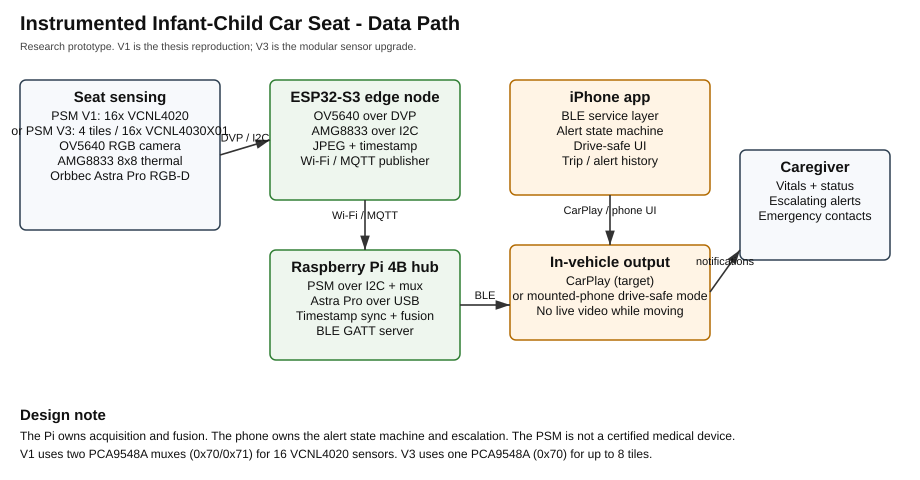
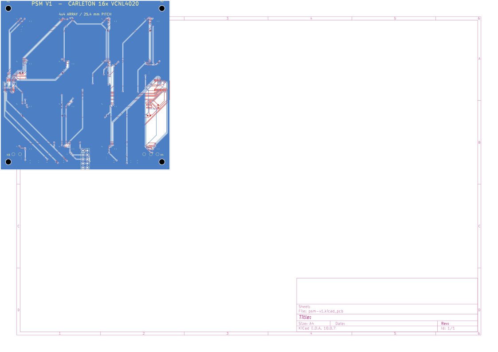
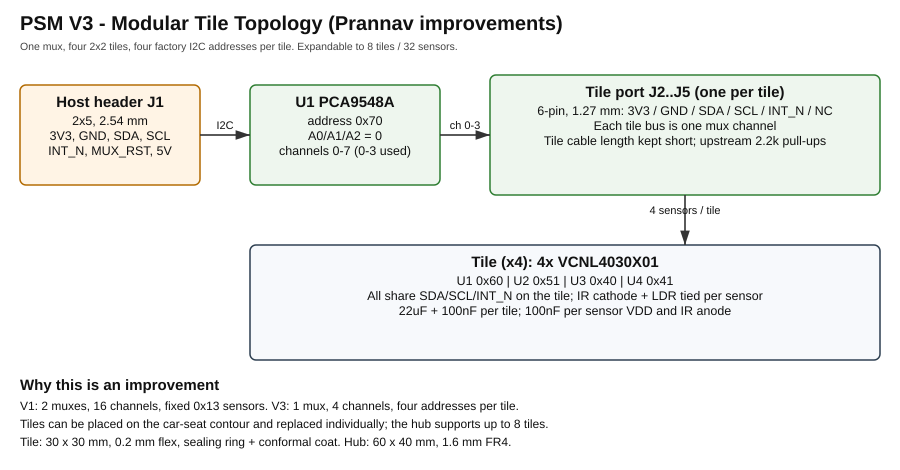
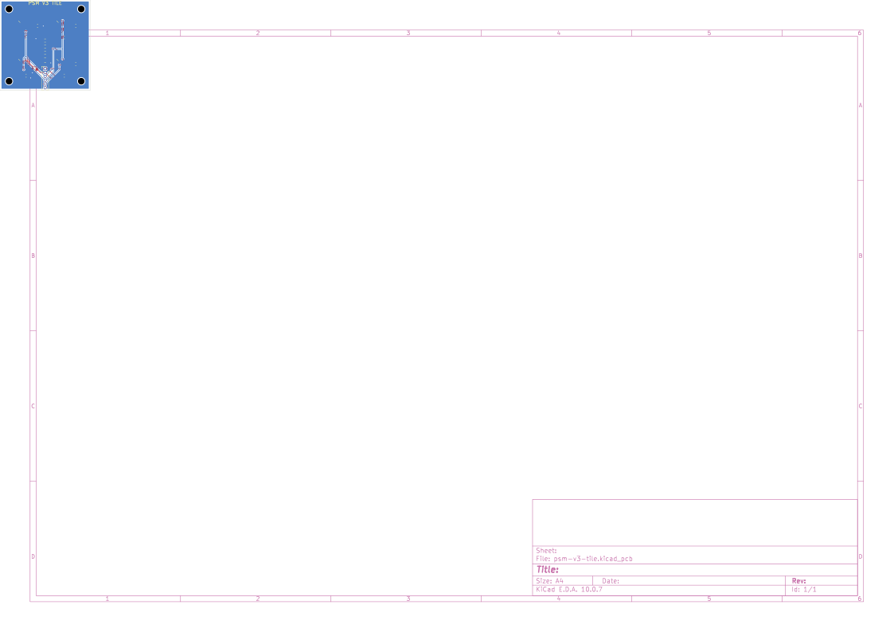
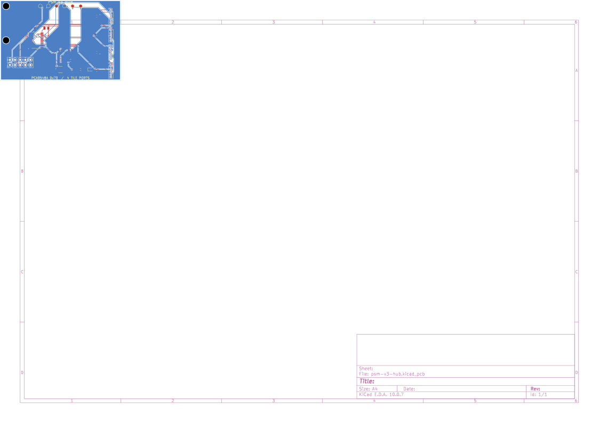
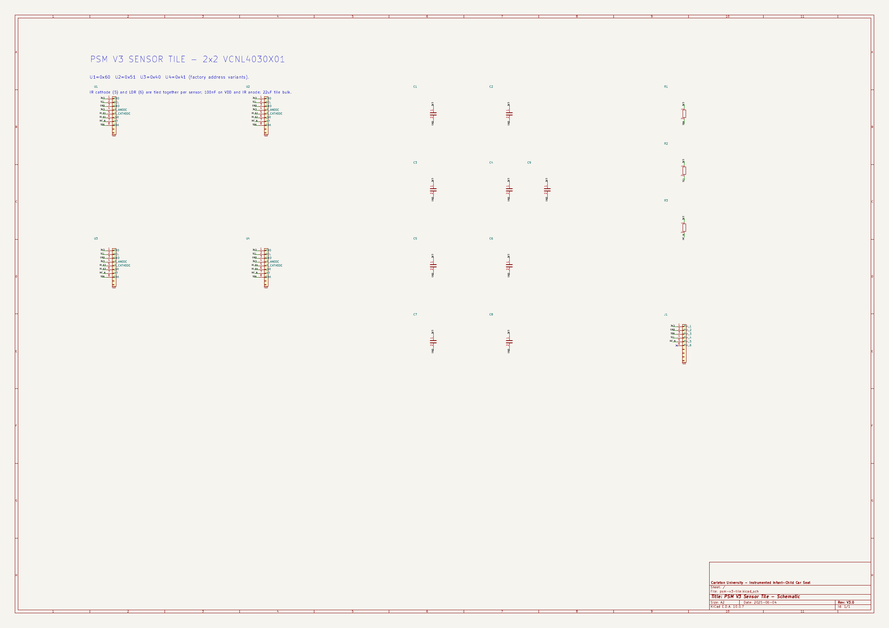
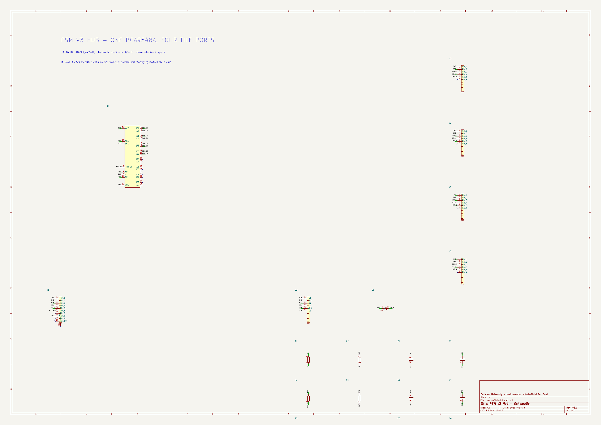

# Instrumented Infant-Child Car Seat — Pressure-Sensitive Mat Hardware

This repository contains the KiCad hardware for the pressure-sensitive mat (PSM)
sub-system of the Carleton University capstone project **Instrumented
Infant-Child Car Seat**.

Two hardware revisions are included:

| Revision | Purpose | Board |
|---|---|---|
| **PSM V1** | Reproduction of Roger Selzler's 2018 thesis PSM (16× VCNL4020, 4×4 array). This is the experimental baseline. | 101.6 × 101.6 mm, 0.2 mm polyimide flex, 2 layers |
| **PSM V3** | Prannav's proposed improvements: VCNL4030X01 sensors, four factory I²C addresses per tile, one mux, modular 2×2 tiles, sealing/waterproofing features. | 4 × 30 × 30 mm flex tiles + 60 × 40 mm FR4 hub |

Both PCB revisions pass KiCad DRC with **0 violations and 0 unconnected
items**. All three schematics pass ERC with **0 violations**. The boards are
research prototypes, not certified medical or automotive devices.

**Interactive board viewer:** open [board-viewer.html](board-viewer.html) in a browser for 3D angled/top/bottom views, 2D copper/silkscreen views, full schematics, and a lightbox.



## Repository map

```
hardware/
  libraries/                 custom footprints + symbols used by the projects
  psm-v1/                    thesis-baseline KiCad project (schematic + PCB)
    fab/                     Gerbers, drill, position file, PDF/SVG preview
  psm-v3/
    tile/                    modular 4-sensor tile KiCad project (PCB)
    hub/                     one-mux / four-port hub KiCad project (PCB)
docs/                        architecture, design notes, validation, fabrication, tests
mechanical/                  parametric silicone tile mold (OpenSCAD) + process notes
scripts/                     reproducible generators and BOM/plot helpers
firmware/                    optional I²C bring-up script for a Raspberry Pi
```

## Quick start

1. Install KiCad 9 or newer (this design was validated with **KiCad 10.0.7**).
2. Open one of:
   - `hardware/psm-v1/psm-v1.kicad_pro` — schematic + PCB
   - `hardware/psm-v3/tile/psm-v3-tile.kicad_pro` — sensor tile schematic + PCB
   - `hardware/psm-v3/hub/psm-v3-hub.kicad_pro` — hub schematic + PCB
3. The project-local `fp-lib-table` and `sym-lib-table` load the custom
   footprints/symbols from `hardware/libraries/`.
4. Fabrication data is in each project's `fab/` folder. Review the fab notes
   in [docs/fabrication.md](docs/fabrication.md) before ordering.

Command-line checks:

```bash
kicad-cli pcb drc --severity-all --output drc.rpt hardware/psm-v1/psm-v1.kicad_pcb
kicad-cli sch erc --output erc.rpt hardware/psm-v1/psm-v1.kicad_sch
kicad-cli pcb drc --severity-all --output drc.rpt hardware/psm-v3/tile/psm-v3-tile.kicad_pcb
kicad-cli pcb drc --severity-all --output drc.rpt hardware/psm-v3/hub/psm-v3-hub.kicad_pcb
```

## PSM V1 — thesis baseline

The V1 board follows Selzler's thesis:

- 16 × **Vishay VCNL4020** infrared proximity sensors in a 4×4 grid on a
  4-inch-square flexible PCB.
- Two **PCA9548A** 8-channel I²C switches at 0x70 and 0x71. Each VCNL4020 has
  the fixed 7-bit address 0x13, so each sensor gets its own mux channel:
  - U17 channels 0–7 → U1–U8
  - U18 channels 0–7 → U9–U16
- 10 Ω IR-anode series resistors, 100 nF local decoupling per sensor,
  22 µF bulk per mux, 4.7 kΩ upstream I²C pull-ups, 10 kΩ reset/INT pull-ups.
- 2×5, 2.54 mm host header (Tiva/LaunchPad-compatible).
- 25.4 mm sensor pitch, 0.2 mm polyimide flex stack-up, 2 layers.



The editable schematic is `hardware/psm-v1/psm-v1.kicad_sch`; a PDF is at
[docs/psm-v1-schematic.pdf](docs/psm-v1-schematic.pdf).

> **Important:** the thesis does not publish a complete netlist, BOM, or
> mechanical drawing. The V1 design is a reconstruction from the thesis text
> and the Vishay datasheet. Verify the silicone cavity geometry against the
> original before fabrication.

## PSM V3 — modular, serviceable upgrade

V3 implements the improvement points from Prannav's proposal sections:

| Proposal point | Implementation |
|---|---|
| Replace the NRND VCNL4020 | **VCNL4030X01** (AEC-Q101, 16-bit PS, four factory addresses) |
| Reduce mux complexity / improve addressing | One **PCA9548A** (0x70) serves four tile ports; each tile has four sensors at 0x60/0x51/0x40/0x41. One mux supports up to 8 tiles / 32 sensors. |
| Do not restrict the array to 4×4 | Modular **2×2 sensor tiles** (30 × 30 mm) can be placed along the car-seat contour and replaced individually. |
| Waterproofing / infant environment | Sealing-ring guide on `Dwgs.User`, ground ring, via tenting/plugging option, ENIG finish, conformal-coat instructions, sealed connectors. |
| Silicone manufacturing | Parametric vacuum-degassing mold in `mechanical/tile_mold.scad` plus process notes. |
| KiCad design package | Full tile and hub PCB projects, BOM, Gerbers, drill, position files, PDF/SVG previews. |



| V3 tile PCB | V3 hub PCB |
|---|---|
|  |  |

| V3 tile schematic | V3 hub schematic |
|---|---|
|  |  |

The V3 projects include full schematics (`psm-v3-tile.kicad_sch` and
`psm-v3-hub.kicad_sch`), the connection topology diagram, and the routed PCBs.
Schematics are in [docs/psm-v3-tile-schematic.pdf](docs/psm-v3-tile-schematic.pdf)
and [docs/psm-v3-hub-schematic.pdf](docs/psm-v3-hub-schematic.pdf).

## Pinouts and address map

### V1 host header J1 (2×5, 2.54 mm)

| Pin | Net | Pin | Net |
|---:|---|---:|---|
| 1 | 3V3 | 2 | GND |
| 3 | SDA | 4 | SCL |
| 5 | INT_N | 6 | MUX_RST |
| 7 | 5V (optional) | 8 | GND |
| 9 | NC | 10 | NC |

### V1 sensor channel map

| Mux | Address | Channel 0 | 1 | 2 | 3 | 4 | 5 | 6 | 7 |
|---|---|---|---|---|---|---|---|---|---|
| U17 | 0x70 | U1 | U2 | U3 | U4 | U5 | U6 | U7 | U8 |
| U18 | 0x71 | U9 | U10 | U11 | U12 | U13 | U14 | U15 | U16 |

### V1 VCNL4020 pin use

| Pin | Name | Connection |
|---:|---|---|
| 1 | IR anode | 3V3 through 10 Ω; 100 nF to GND |
| 2 | SDA | Mux channel `SDA_Cn` |
| 3 | INT | `INT_N` (open-drain, 10 kΩ pull-up) |
| 4 | SCL | Mux channel `SCL_Cn` |
| 5 | VDD | 3V3; 100 nF to GND |
| 6, 7 | NC | Not connected |
| 8, 9 | GND | GND |
| 10 | IR cathode | Not connected (internal emitter) |

### V3 tile connector J1 (1×6, 1.27 mm)

| Pin | Net |
|---:|---|
| 1 | 3V3 |
| 2 | GND |
| 3 | SDA |
| 4 | SCL |
| 5 | INT_N |
| 6 | NC (future) |

### V3 tile sensor addresses

| Sensor | Order code | 7-bit address |
|---|---|---:|
| U1 | VCNL4030X01-GS08 | 0x60 |
| U2 | VCNL40301X01-GS08 | 0x51 |
| U3 | VCNL40302X01-GS08 | 0x40 |
| U4 | VCNL40303X01-GS08 | 0x41 |

### V3 hub ports

| Hub port | Mux channel | Tile |
|---|---|---|
| J2 | 0 | Tile 0 |
| J3 | 1 | Tile 1 |
| J4 | 2 | Tile 2 |
| J5 | 3 | Tile 3 |

Host header J1 uses the same pinout as V1. Each tile's IR cathode and LDR
pins are tied together per the VCNL4030X01 datasheet; the IR anode has a
22 µF + 100 nF network per tile and 100 nF per sensor.

## BOM and ordering

See [hardware/BOM.md](hardware/BOM.md) for consolidated BOMs and order codes.
Key notes:

- **VCNL4020** is marked "not for new designs" by Vishay. The V1 board is a
  thesis reproduction; use it for baseline experiments only.
- **VCNL4030X01** is ordered as **four different order codes** to obtain the
  four I²C addresses. Do not substitute a single code for all four tile
  positions.
- The V3 tile footprint omits the exposed pad (EP) to preserve 0.15 mm
  clearance at the QFN. Pin 3 (GND) provides the electrical ground. For a
  production thermal design, add an EP with a laser-cut stencil and a
  reflow-verified 0.1 mm clearance.
- The V1 PSM uses a 0.2 mm polyimide flex. Add stiffeners behind the
  connector and muxes for repeated insertion; this is not modeled in KiCad.

## Validation

| Check | Result |
|---|---|
| V1 PCB DRC | 0 violations, 0 unconnected |
| V1 schematic ERC | 0 violations |
| V3 tile PCB DRC | 0 violations, 0 unconnected |
| V3 tile schematic ERC | 0 violations |
| V3 hub PCB DRC | 0 violations, 0 unconnected |
| V3 hub schematic ERC | 0 violations |
| Schematic-to-PCB netlist | 0 mismatches (all 3 designs) |

Details and reproduction commands are in
[docs/validation.md](docs/validation.md).

## Fabrication, assembly, and testing

- [docs/fabrication.md](docs/fabrication.md) — stack-ups, finish, via
  tenting/plugging, conformal coating, sealing, silicone process.
- [docs/testing.md](docs/testing.md) — bring-up, I²C scan, pressure/linearity,
  respiration, flex, and vehicle test plan.
- [docs/design-notes.md](docs/design-notes.md) — assumptions, V1→V3 mapping,
  open issues.
- [mechanical/README.md](mechanical/README.md) — vacuum-degassing mold and
  silicone process.

## Status and limitations

**Implemented**

- Full V1 schematic and routed PCB.
- Full V3 tile and hub schematics and routed PCBs.
- Custom VCNL4020/VCNL4030X01 footprints and PSM symbol library.
- Fabrication outputs, BOMs, and validation reports.
- Approximate STEP 3D models for the custom VCNL4020 and VCNL4030X01 packages, used for 3D renders in the board viewer.

**Not implemented / not validated**

- No boards have been fabricated or electrically tested.
- No firmware, sensor-fusion pipeline, or app code is included.
- No silicone samples, flex-bend fatigue, thermal, EMC, or crash-safety
  testing.
- No medical or automotive certification. The system is a research
  prototype and must not be used as a medical device or as a substitute for
  a certified child restraint.
- The V1 design is a reconstruction; the original thesis hardware may differ
  in mux part number, board outline, and silicone geometry.

## Sources and attribution

- R. C. D. G. Selzler, *Development of a Novel Pressure-Sensitive Mat Using
  Proximity Sensors*, M.A.Sc. thesis, Carleton University, 2018.
- Capstone proposal, *Instrumented Infant-Child Car Seat*, 2026
  (Prannav's PSM sections and the V3 improvement points).
- Vishay VCNL4020 and VCNL4030X01 datasheets; TI PCA9548A datasheet.

Third-party symbol/footprint attribution is in
[docs/attribution.md](docs/attribution.md). The reference PDFs are not
committed to this repository.

## License

Original hardware design files and documentation in this repository are
released under the MIT License (see `LICENSE`). Third-party KiCad library
elements retain their original licenses; see `docs/attribution.md`.
